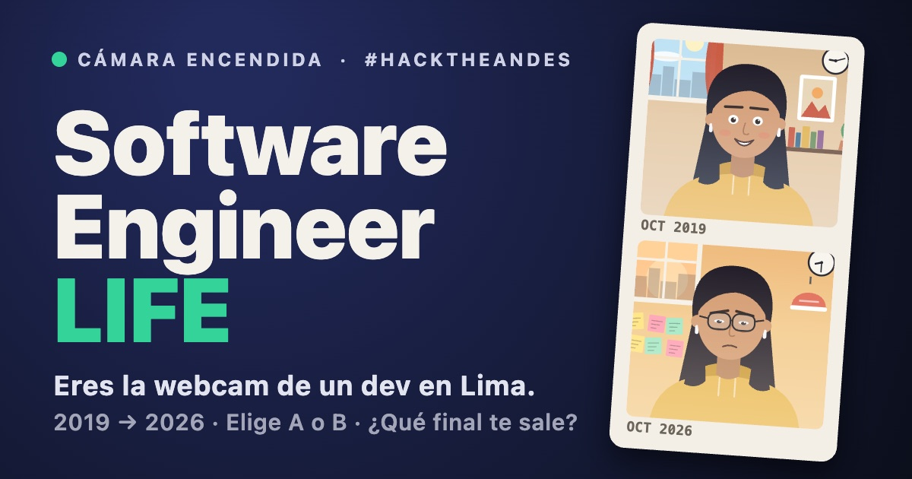
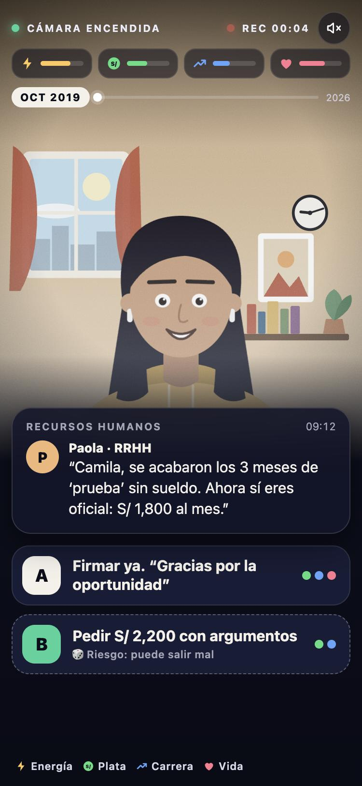
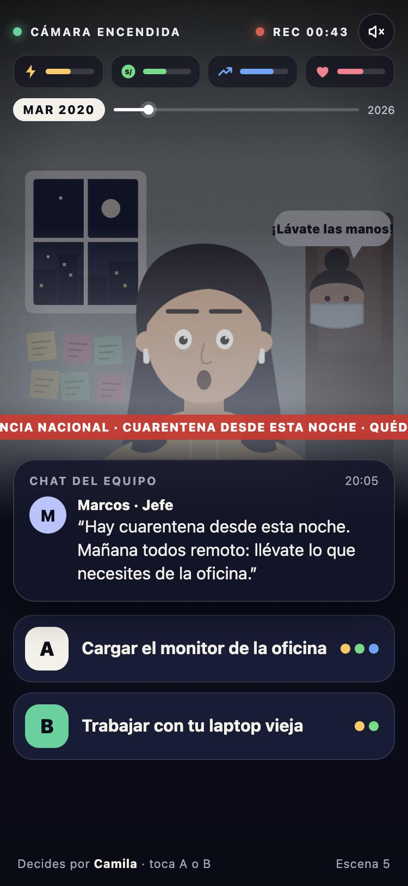
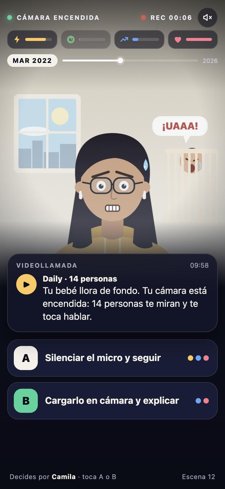
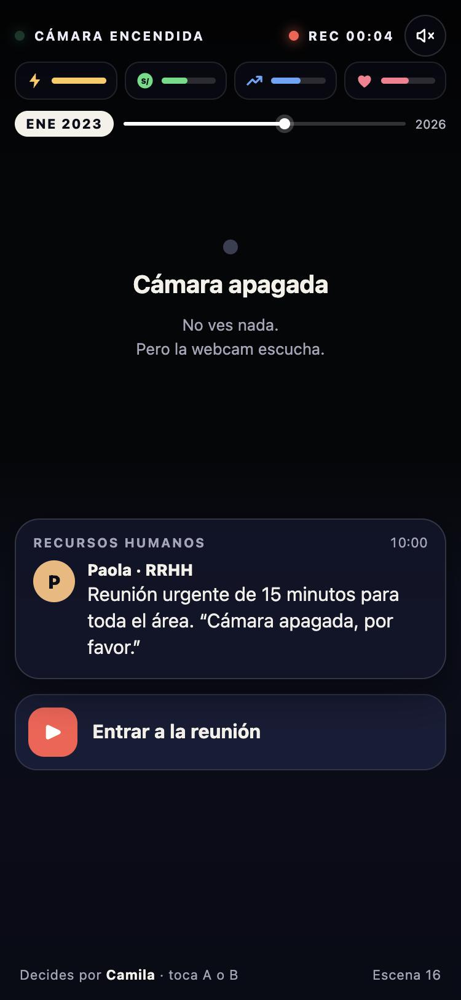
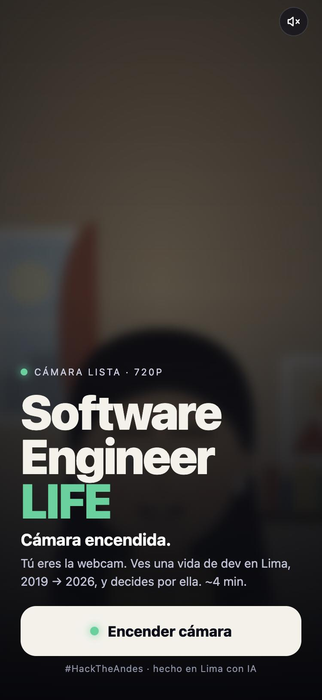
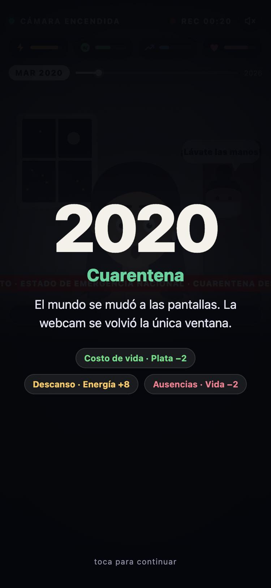
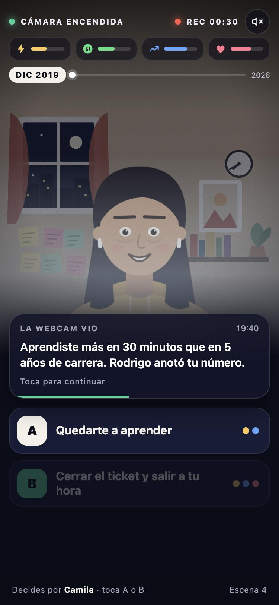
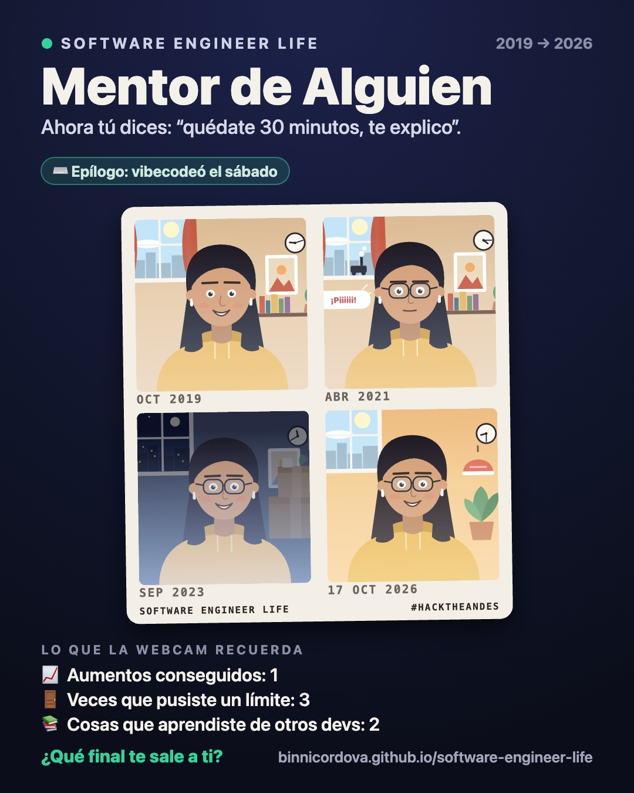
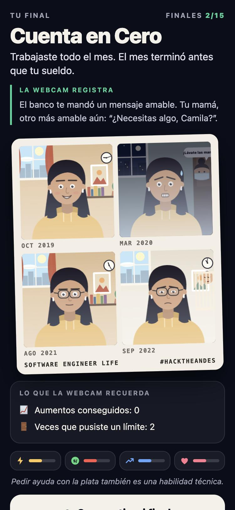

<div align="center">

# Software Engineer LIFE
### *cámara encendida*

**Eres la webcam de un dev en Lima. 2019 → 2026. Dos opciones por escena. Una vida entera.**

[**▶ Jugar ahora**](https://binnicordova.github.io/software-engineer-life/) · pensado para el **celular** · ~4 min · gratis, sin registro



*Hecho en Lima con IA para el reto [“Vibecodea un juego”](https://hacktheandes.com/game) · `#HackTheAndes`*

</div>

---

## 🎯 El objetivo

Un periodo de prueba sin sueldo. Una cuarentena. Horas extra “por favor”. Un mentor que renuncia. Un bebé que llora en el *daily*. Recortes. Un ascenso **sin aumento**. Un agente de IA que “duplica tu productividad”.

Tú no eres el ingeniero: **eres la webcam de su laptop**. Lo ves vivir siete años y, cada vez que le llega una notificación, decides por él o ella: **A o B**. Nadie te preguntó qué opinas… hasta ahora.

**Tu meta:** llegar a **2026** sin que se te acabe ningún medidor.

| Medidor | Qué es |
|---|---|
| ⚡ **Energía** | Sueño, salud, ganas de seguir |
| **S/ Plata** | Tu sueldo contra el costo de vida (que sube cada año… tu sueldo no) |
| 📈 **Carrera** | Reputación y visibilidad |
| ❤️ **Vida** | Familia, amigos, cabeza |

Cada opción **cuesta algo**: aceptar el “favorcito” te da Carrera pero te quita Energía y Vida; poner un límite te cuida, pero Marcos lo anota. No hay una respuesta correcta, solo **15 finales** distintos y una pregunta para cuando termines: *¿qué final te sale a ti?*

- Si **un medidor llega a cero**, la historia termina ahí: *Burnout Certificado*, *Cuenta en Cero*, *Ghosteado por RRHH*, *Cero Bugs, Cero Invitados*…
- Si **llegas a 2026**, tu vida decide el final: *El Equilibrista*, *Tech Lead sin Aumento*, *Mentor de Alguien*, *Despedido y Mejor Pagado*, *El Cuerpo Cobra*… y más.
- Tu última decisión (**vibecodear el sábado o cerrar la laptop y salir a caminar**) queda como un *epílogo* en cualquier final.

---

## 📷 La inmersión: tú eres la webcam

Todo el juego se ve **a través de una cámara web**, nunca fuera de ella.

<table>
<tr>
<td width="25%" align="center"><br><sub><b>Una notificación, dos opciones.</b><br>Los puntos de colores te dicen qué medidores toca, no si suben o bajan.</sub></td>
<td width="25%" align="center"><br><sub><b>El mundo entra por la cámara.</b><br>Noticias, mamá con mascarilla en la puerta, la luz de un cuarto de cuarentena.</sub></td>
<td width="25%" align="center"><br><sub><b>El caos de trabajar desde casa.</b><br>Un bebé llorando, un taladro, el camotero, mamá gritando “¡almuerzo!”.</sub></td>
<td width="25%" align="center"><br><sub><b>“Cámara apagada, por favor.”</b><br>En la reunión de RR. HH. no ves nada. Pero la webcam escucha.</sub></td>
</tr>
</table>

**Lo que hace que se sienta como una webcam, no como un menú:**

- 🎞️ **La imagen es el medidor.** Mientras baja la Energía, la cámara pierde color, se oscurece y aparece grano. Los ojos del ingeniero se cansan, le salen ojeras y, desde 2021, lentes.
- 🏠 **El cuarto cuenta la historia.** Sin texto: más *stickies* en la pared cuando te quedas “un ratito más”, tazas que se acumulan con el estrés, cajas de cartón si te despiden, una cuna que después es un peque saludando a cámara.
- 📅 **Cada año abre con una tarjeta** que muestra lo que costó: *costo de vida*, *descanso* y *ausencias* (lo que perdiste en casa por quedarte trabajando).
- 🔌 **Cosas que solo pasan en videollamada:** se cae el internet (la imagen se corta y se desfasa), se va la luz (solo brilla tu pantalla), el silbato del camotero justo cuando te toca hablar.
- 🔊 **Sonido sintetizado** (opcional): notificaciones, obturador de cámara, llanto de bebé, taladro. Sin archivos de audio.
- 🧠 **La webcam recuerda.** Tus decisiones vuelven: un favor de 2019 puede ser la referencia que te consigue trabajo en 2023, ignorar una señal del cuerpo se cobra en plena reunión, y el *“quédate 30 minutos, te explico”* que te dijeron… quizá tengas que decirlo tú.

<table>
<tr>
<td width="33%" align="center"><br><sub><b>Encender cámara</b></sub></td>
<td width="33%" align="center"><br><sub><b>Cada año tiene su costo</b></sub></td>
<td width="33%" align="center"><br><sub><b>“La webcam vio…”</b></sub></td>
</tr>
</table>

---

## 🎞️ El final es una tira de fotos (para compartir)

Al terminar, el juego revela una **tira Photo Booth** con cuatro cuadros de *tu* partida (2019 → 2026), el título de tu final, una frase burlona y **“Lo que la webcam recuerda”** (por ejemplo: *Aumentos conseguidos: 0*, *Veces que dijiste “un ratito más”: 4*).

<div align="center">

</div>

- **Compartir mi final** exporta la imagen (PNG 4:5) lista para WhatsApp, LinkedIn, X o Instagram.
- **Retar a un amigo** copia un enlace con la misma semilla: viven **el mismo mundo** (mismos eventos y mismos dados), con decisiones distintas.
- Cada final tiene su propia página (`/e/<final>/`), así que el enlace que compartes **muestra tu final** en la vista previa.

<div align="center">

</div>

> 🫶 El juego usa humor oscuro sobre agotamiento y trabajo, pero termina siempre con una línea de cuidado. Si algo te suena demasiado cercano: descansar y pedir ayuda también son decisiones técnicas.

---

## 🧭 Las historias que se entrelazan

| Hilo | Cómo evoluciona |
|---|---|
| 🧑‍🏫 **El mentor** | Rodrigo te enseña en 2019 → se va a una empresa en dólares (2021) → te puede referir si te despiden (2023) → un practicante te pide ayuda (2025). |
| 💸 **El sueldo** | “Es un favorcito, no se paga pero se valora”. Horas extra, ascenso sin aumento, el 7.º aniversario en *la misma banda salarial*. |
| 🫀 **El cuerpo** | El estrés oculto se acumula → la doctora te lo advierte → si lo ignoras, el cuerpo cobra. |
| 🏡 **La casa** | Aportar en casa, la feria de papá que cierra, mudarse con tu pareja, un bebé, un peque saludando en cámara. |
| 🌎 **El mundo** | Cuarentena (2020), recortes (2023), el agente de IA (2025)… y un sábado de octubre de 2026 en Lima. |

49 escenas · 15 finales · 8 actos (2019 → 2026) · acento limeño (S/, quincena, menú, camotero).

---

## 🛠️ Para devs

- **Stack:** HTML + CSS + JavaScript puro. **Sin dependencias ni build.** Todo el arte es SVG generado por código (cero imágenes del juego). ~48 KB comprimido.
- **Motor sin DOM** (`public/js/engine.js`) con azar determinista por semilla → por eso existe el reto entre amigos y un **simulador de balance** (`node tools/sim.mjs`) que juega miles de partidas con bots.
- **PWA:** funciona sin conexión después de la primera carga (pensado para el Wi-Fi de un evento).
- **Contenido como datos:** todas las escenas, finales y reglas están en [`public/js/data.js`](public/js/data.js).

```bash
python3 -m http.server 5173 --directory public     # http://localhost:5173
node tools/check.mjs                               # lint del contenido
node tools/sim.mjs 4000                            # balance con bots
```

Guía completa (estructura, cómo escribir escenas, despliegue): [`docs/DEVELOPMENT.md`](docs/DEVELOPMENT.md) · Diseño y planificación del juego: [`plan/`](plan/README.md).

---

## 🇬🇧 In English

**Software Engineer LIFE — *camera on*** is a mobile-first narrative game. You are the webcam of a software engineer in Lima, 2019 → 2026: each scene is a notification with two choices (A/B) about unpaid overtime, a pandemic, a mentor who leaves, a baby crying on a team call, layoffs, a promotion without a raise and an AI agent that “doubles your output”. Keep four meters (Energy, Money, Career, Life) above zero to reach 2026, discover 15 endings, and share your result as a Photo Booth strip. Built with vanilla JS and generated SVG art, no dependencies; playable at **https://binnicordova.github.io/software-engineer-life/**. Text is in Spanish.

<div align="center"><sub>Hecho para el reto <b>Vibecodea un juego</b> de Hack the Andes · #HackTheAndes</sub></div>
